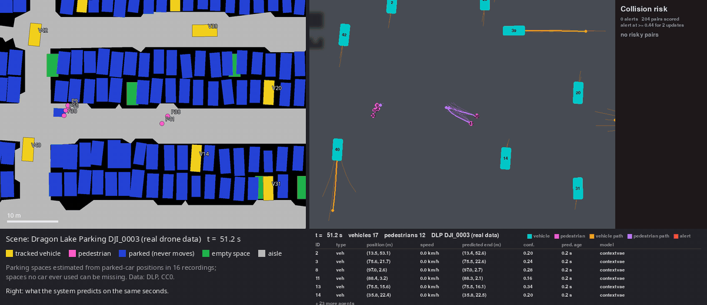
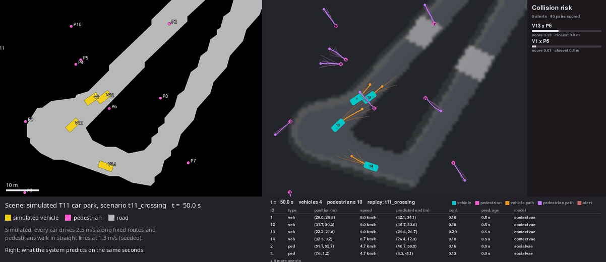
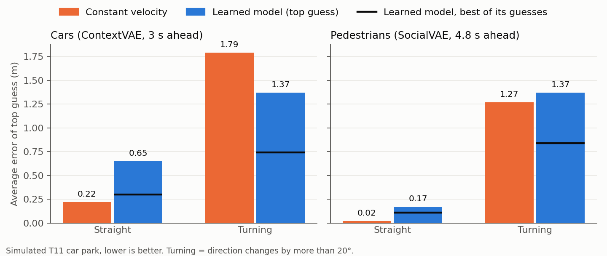
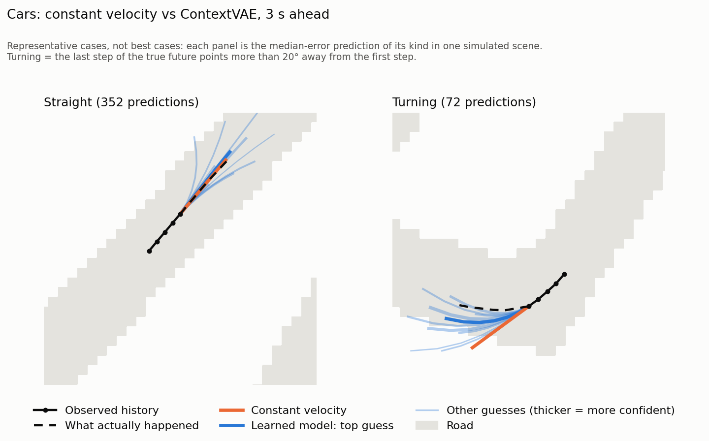
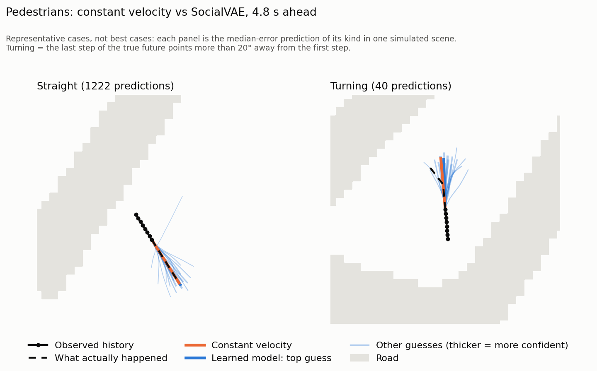
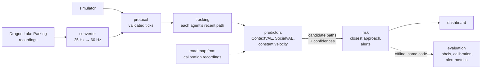

# Variational Bayesian trajectory prediction and collision-risk alerts

[](https://github.com/MIpandaRA/trajectory-risk/actions/workflows/tests.yml)

A live system that watches a car park, predicts where every car and pedestrian
will go over the next few seconds, and raises an alert when a car and a person
are likely to come too close. Cars are predicted by **ContextVAE**, which reads the neighbouring car and
the road map; pedestrians by **SocialVAE**, which accounts for people nearby.
Both are conditional variational autoencoders: they draw hundreds of possible
futures and summarise them as a few candidate paths with confidences. It runs
on a built-in simulator and on real drone recordings, feeding a live
dashboard at 60 updates a second.



*Real drone data: [Dragon Lake Parking](https://sites.google.com/berkeley.edu/dlp-dataset)
recording DJI_0003, 51–69 s. **Left**, the scene: parked cars, aisles, the
tracked vehicles and pedestrians, all drawn from the CC0 recordings (parking
spaces are estimated from where cars parked). **Right**, the same seconds in the
dashboard: orange and violet lines are the predicted futures of vehicles and
pedestrians, a red ring is an active alert, and the panel lists the calibrated
risk of each car–pedestrian pair. The dataset authors' own semantic
visualization and annotated video are on their
[project page](https://sites.google.com/berkeley.edu/dlp-dataset).*

## What it does

* **Predicts several futures per agent, live.** A single "best guess" model
  averages left and right turns into a path nobody takes
  ([why](docs/figures/cvae_toy.png)); these models keep both.
* **Scores risk over time, not just geometry.** Every candidate car path is
  compared with every candidate pedestrian path *at the same moments* over the
  next 3 s. Two paths that cross 5 s apart are safe.
* **Alerts without flickering.** An alert needs several high readings in a row
  to switch on and several low ones to switch off.
* **Stays responsive when the models are slow.** Models run on background
  threads; a new request replaces a waiting one instead of queueing behind it.
* **Is measured, not just demoed.** Every result is compared with constant
  velocity ("everyone keeps going straight at their current speed"), and the
  real-data evaluation follows an analysis plan fixed before any model ran.

## Results on real data

16 recordings of the Dragon Lake Parking dataset (a 140 × 80 m car park, drone
tracking at 25 Hz), split **by recording** into 10 calibration and 6 test
recordings with a fixed seed. The map and every fitted parameter come from the
calibration recordings only. Results are on the test recordings, for car–pedestrian
pairs within 15 m; ranges are 95% bootstrap intervals over the 6 recordings.

**The event.** A car and a pedestrian come within **2.5 m** (centre to centre)
at some moment in the next 3 s **while the car is moving** faster than 0.5 m/s.
2.5 m is half a car's measured width (1.09 m) + half a pedestrian's box
(0.42 m) + a 1 m margin. The definition was fixed from true positions only,
before any model output existed ([docs/dlp_event_definition.md](docs/dlp_event_definition.md)).
It is rare: 0.81% of nearby pair-updates, from 177 separate encounters in the
test recordings.

| Finding | Number |
|---|---|
| The raw risk score is overconfident | expected calibration error 0.069, about 8.5× the base rate |
| Recalibrated (isotonic, fitted on calibration recordings) | calibration error **0.0012**; Brier skill **0.18 [0.05, 0.27]**† |
| Learned vs constant-velocity score, at the baseline's 61% recall | precision **0.07** vs **0.63**†; the baseline scores 0 on 39% of conflict moments† |
| Demo alert setting, run once on test | 1.34 false alerts/min [0.61, 2.02], **72%** of conflicts caught, median warning **−0.25 s**† |

† Exploratory: analyses added after the test results had been seen.

* **The raw score ranks well but is not a probability.** It ranks dangerous
  moments above safe ones well (AUROC 0.94), but its numbers are about ten
  times too high.
  Fitted on separate recordings, recalibration fixes this, leaving a modest
  real improvement over always predicting the base rate (Brier skill 0.18).
* **Constant velocity is the better alarm where an alarm would operate.** At
  the same recall it is right nine times as often. The learned score's
  advantage is coverage: it is the only one of the two that can catch more than
  61% of conflicts, at much lower precision.
* **Alerts detect conflicts; they do not warn ahead of them.** 103 of the 128
  alerted conflicts were flagged after the car and pedestrian had already come
  within 2.5 m. The simulator's advance warning (below) did not carry over to
  real traffic. Why is still an open question: stale predictions, the
  two-update alert rule (about 0.45 s), or a score that tracks current rather
  than future closeness.

## Results in simulation

The built-in simulator, on two maps: **T11**, a small car park, and
**OneNorth**, a nuScenes map (the data ContextVAE was trained on). Simulated
cars never change speed and pedestrians walk in straight lines, which flatters
constant velocity.



*Simulated T11 car park, scenario `t11_crossing`, 40–54 s. **Left**, the
simulated scene: road, cars and pedestrians. **Right**, the same seconds in the
dashboard, with each agent's predicted futures and the risk panel.*



* **On straight roads, the baseline wins.** That is exactly constant
  velocity's assumption.
* **On turns, ContextVAE wins for cars**: its predictions bend with the road.
  On OneNorth, where cars are faster, the gap is larger: 8.0 m vs 9.8 m on
  turns, while on straight roads the baseline is far ahead (0.78 m vs 2.61 m).
* **For pedestrians, the baseline wins everywhere.** SocialVAE, trained on real
  people who wander, predicts a spread that simulated walkers never show.
* **The learned models usually have a good guess, but not first.** The black
  line in each blue bar is the best of all their candidates.





| Alerts, all simulated scenarios, default settings | Learned models | Constant velocity |
|---|---|---|
| Danger events caught | **41 of 42** | 39 of 42 |
| False alarms per minute | 3.5 | **0.8** |
| Median warning before closest approach | **2.6 s** | 2.2 s |

## How it works



Module by module, with the reason each one exists: [docs/architecture.md](docs/architecture.md).

## Quick start

Python 3.10 (the model weights need torch 1.11). Using [uv](https://docs.astral.sh/uv/):

```bash
git clone https://github.com/MIpandaRA/trajectory-risk.git
cd trajectory-risk
uv venv --python 3.10 .venv && source .venv/bin/activate
uv pip install "torch==1.11.0+cpu" "torchvision==0.12.0+cpu" --index-url https://download.pytorch.org/whl/cpu
uv pip install -e ".[dev]"
```

**Fedora and other distributions with glibc 2.41+:** torch 1.11 fails to load
with "cannot enable executable stack". Clear the flag once:

```bash
uv pip install patchelf
for f in .venv/lib/python3.10/site-packages/torch/lib/*.so*; do patchelf --clear-execstack "$f"; done
```

**Model weights** are not in this repository (`checkpoints/` is ignored). Both
are the authors' own pretrained models:

```bash
mkdir -p checkpoints/contextvae checkpoints/socialvae
# ContextVAE, nuScenes / ResNet-18, from the ContextVAE "pretrained" release
curl -L -o checkpoints/contextvae/ckpt-best \
  https://github.com/xupei0610/ContextVAE/releases/download/pretrained/nuscenes_res18
# SocialVAE, Stanford Drone Dataset, from the SocialVAE repository
curl -L -o checkpoints/socialvae/ckpt-best \
  https://github.com/xupei0610/SocialVAE/raw/main/models/sdd/ckpt-best
```

Without weights, everything still runs with the constant-velocity baseline
(`--models cv`).

### Run it live

Two terminals:

```bash
traj-producer --map T11 --num-pedestrians 10 --crossing-bias 0.6 --autostart   # simulator
traj-dashboard --map T11                                                       # predictions and alerts
```

In the dashboard: **D** debug overlay (model latency, superseded requests),
**A** alternative candidates, **Esc** quit.

### Real drone data

```bash
python scripts/download_dlp.py DJI_0003      # raw JSON from Zenodo -> data/dlp/raw/ (not in git)
traj-dlp-convert DJI_0003                    # -> data/dlp/DJI_0003.jsonl.gz
traj-replay data/dlp/DJI_0003.jsonl.gz       # terminal 1
traj-dashboard --map DLP                     # terminal 2
```

This repository uses recordings DJI_0001–0016. DJI_0017–0030 have never been
used and are reserved for a pre-registered follow-up study.

### Reproduce the results

Simulation (about 30 min on a laptop CPU):

```bash
python -m eval.run_predictions && python -m eval.accuracy && python -m eval.risk_eval
python -m eval.compare_vehicles && python -m eval.compare_pedestrians && python -m eval.make_figures
python scripts/render_dlp_side_by_side.py --scenario t11_crossing --start 40 --seconds 14 --out demo/t11_side_by_side.gif
```

Real data (download and convert DJI_0001–0016 first; the prediction step takes
about a day and a half on a laptop CPU, everything else minutes):

```bash
# the calibration/test split is fixed and in git: data/dlp/splits.json
traj-dlp-convert --split calibration --build-map --no-convert                   # maps/DLP (also in git)
python -m eval.dlp_labels && python -m eval.dlp_label_quality                   # event labels
python -m eval.dlp_predict --models cv learned --split calibration test         # predictions
python -m eval.dlp_risk --models learned cv --split calibration test
python -m eval.dlp_calibration --split calibration && python -m eval.dlp_calibration --split test
python -m eval.dlp_exploratory && python -m eval.dlp_exploratory --extra        # † analyses
python -m eval.dlp_alerts && python -m eval.dlp_alerts --test-once              # alert setting
python scripts/render_dlp_side_by_side.py                                       # demo/dlp_side_by_side.gif
```

The OneNorth scenario needs `maps/OneNorthRoundabout/semantic_map.pkl` (85 MB,
not in the repository).

### Tests

```bash
pytest
```

Tests that need the model weights or the OneNorth map are skipped when those
files are absent.

## Limitations

* **Car and pedestrian are assumed not to react to each other.** The risk score
  multiplies the car's and the pedestrian's candidate confidences, which is
  only valid if their futures are independent. In reality a pedestrian who sees
  a car swerve is less likely to step out. The models cannot supply that
  dependence: ContextVAE only sees other cars as neighbours and SocialVAE only
  other pedestrians, and each predicts on its own. Capturing it would need a
  **joint prediction model** that samples both agents' futures together as
  consistent pairs.
* **Distance ignores direction.** The event uses centre-to-centre distance, so
  a pedestrian just in front of a bumper (about 3 m from a car's centre) is not
  an event. Front and back approaches are 1–5% of conflicts here.
* **Cyclists are left out.** DLP has 28 in total; SocialVAE was trained on
  walkers only.

## Acknowledgements and licences

* Code in this repository: [MIT](LICENSE), © 2026 MIpandaRA.
* **Dragon Lake Parking dataset**: Shen, Pan, Govindarajan, Borrelli (UC
  Berkeley MPC Lab), [CC0](https://zenodo.org/records/10084683)
  (doi:10.5061/dryad.tht76hf5b). Please cite: X. Shen, M. Lacayo, N. Guggilla,
  F. Borrelli, "ParkPredict+: Multimodal Intent and Motion Prediction for
  Vehicles in Parking Lots with CNN and Transformer", IEEE ITSC 2022,
  doi:10.1109/ITSC55140.2022.9922162. The maps in `maps/DLP*` are derived from
  the CC0 recordings only, not from the dataset's GPL-3 toolkit.
* **ContextVAE** network (`src/trajectory_risk/third_party/contextvae`): MIT,
  © 2023 徐霈 (Pei Xu). Xu, Hayet, Karamouzas, "Context-Aware Timewise VAEs for
  Real-Time Vehicle Trajectory Prediction", IEEE RA-L 8(9), 2023.
* **SocialVAE** network (`src/trajectory_risk/third_party/socialvae`): MIT,
  © 2021 Pei Xu. Xu, Hayet, Karamouzas, "SocialVAE: Human Trajectory Prediction
  using Timewise Latents", ECCV 2022.
* **OneNorth map** (`maps/OneNorthRoundabout`): derived from the
  [nuScenes](https://www.nuscenes.org/) map expansion, **CC BY-NC-SA 4.0**
  (non-commercial, share-alike).
* **T11 road annotations** (`maps/T11`): CC BY 4.0, by MIpandaRA.
* **Model weights** (not distributed here) were trained on nuScenes and the
  Stanford Drone Dataset, whose non-commercial terms may extend to models
  trained on them; treat them as non-commercial.
