# Architecture

The system predicts where cars and pedestrians in a car park will go over the
next few seconds, and raises an alert when a car and a person are likely to
come too close. Two programs run side by side: a **producer** that sends
everyone's position 60 times a second, and a **dashboard** that predicts,
scores risk and draws.

```mermaid
flowchart LR
    subgraph SOURCES["Where positions come from"]
        SIM["<b>sim/</b><br/>simulated car park"]
        DLP["<b>Dragon Lake Parking</b><br/>real drone recordings"]
        CONV["<b>datasets/dlp.py</b><br/>25 Hz frames → 60 Hz ticks"]
        REC["<b>apps/replay.py</b><br/>recorded scenario"]
    end

    TRANS["<b>transport.py</b><br/>TCP, JSON lines"]
    PROTO["<b>protocol.py</b><br/>message format + checks"]
    TRACK["<b>tracking.py</b><br/>each agent's recent path"]
    WORK["<b>runtime/worker.py</b><br/>background inference"]
    PRED["<b>predictors/</b><br/>ContextVAE, SocialVAE,<br/>constant velocity"]
    RISK["<b>risk.py</b><br/>car–person risk, alerts"]
    DASH["<b>dashboard/</b><br/>draws it live"]
    MAP["<b>datasets/dlp_map.py</b><br/>road map from where<br/>cars actually drove"]
    EVAL["<b>eval/</b> + <b>calibration.py</b><br/>event labels, calibration,<br/>alert evaluation"]
    GEO["<b>geometry.py</b><br/>screen ↔ world ↔ ego"]

    DLP --> CONV --> REC
    SIM --> TRANS
    REC --> TRANS
    TRANS --> PROTO
    PROTO -- "tick: every agent,<br/>world metres, 60×/s" --> TRACK
    TRACK -- "one agent's past,<br/>fixed time steps" --> WORK
    WORK --> PRED
    PRED -- "candidate paths<br/>+ confidences" --> RISK
    PRED --> DASH
    RISK --> DASH

    DLP -. "calibration<br/>recordings only" .-> MAP
    MAP -. "road map" .-> PRED
    RISK -. "offline, same code" .-> EVAL
    GEO -. "pixels ↔ metres" .-> SIM
    GEO -. "pixels ↔ metres" .-> DASH
    GEO -. "rotate into the<br/>model's frame" .-> PRED

    classDef mod fill:#d4edda,stroke:#2e7d32,stroke-width:2px,color:#000
    classDef data fill:#dbe8fb,stroke:#2a5ea8,stroke-width:2px,color:#000
    class SIM,CONV,REC,TRANS,PROTO,TRACK,WORK,PRED,RISK,DASH,MAP,EVAL,GEO mod
    class DLP data
```

Solid arrows carry live data; dotted arrows are inputs built offline or
conversions ("uses these"). Blue is external data; green is this repository's code.
`pipeline.py` is everything inside the dashboard except the network, the
threads and the drawing, so the offline evaluation runs the same code as the
live system.

## Modules

| Module | Job | Why it is its own module |
|---|---|---|
| `geometry.py` | Converts between three coordinate frames: **screen** (pixels, y down), **world** (metres, y up) and **ego** (rotated about the agent's oldest observed position so it faces +x, the frame ContextVAE was trained in). | Every conversion lives in one place, so the y-axis is flipped exactly once. A second flip anywhere would mirror every prediction, and mirrored paths still look plausible on screen. |
| `protocol.py` | Defines the message the producer sends: one JSON line per tick, every agent's position in world metres, with units in the field names. Every malformed message is rejected with one error type. | Both sides import the same rulebook, so they cannot drift apart, and bad data is stopped at the door instead of surfacing later as a nonsense prediction or a crash. |
| `sim/` + `maps.py` | A seeded simulator of cars on fixed routes and pedestrians off the road. Steps exactly 1/60 s and sends the same messages as any other producer. | A fixed step makes every timestamp true by construction, and a seed makes every scenario repeatable, so tests and comparisons see identical input. |
| `transport.py` | Sends ticks from producer to dashboard over a local TCP connection. | Neither side can stall the other: a stuck consumer is disconnected, and a slow one drops its oldest waiting messages. |
| `tracking.py` | Turns the 60-per-second stream into each agent's recent path, keeping one sample every 0.5 s (cars) or 0.4 s (pedestrians), chosen by simulation time. Drops agents that have left. | Each model must see history at the spacing it was trained on. Sampling by time instead of "every 30th message" stays correct when messages arrive unevenly. |
| `predictors/` | One interface, three models: constant velocity (the baseline), ContextVAE for cars (uses the road map), SocialVAE for pedestrians (uses nearby people). The learned models draw hundreds of futures and cluster them into 10–20 candidates. | The rest of the system never needs to know which model answered, so models can be swapped and compared. The network code in `third_party/` is unmodified upstream code. |
| `runtime/worker.py` | Runs each model on a background thread. | The window never waits for a model. If a new request for an agent arrives while its old one is still waiting, the old one is dropped instead of queued. |
| `risk.py` | Drops the stale part of each prediction, puts car and pedestrian candidates on one 0.1 s clock, finds each pair's closest approach at the same moment, and turns it into a risk score and an on/off alert. | Same-time distance, not path intersection: two paths that cross 5 s apart are safe. |
| `dashboard/`, `apps/` | The window, and the command-line programs (`traj-producer`, `traj-dashboard`, `traj-replay`, `traj-record`, `traj-generate`, `traj-dlp-convert`). | Drawing only, no logic, so the same frames can be rendered live or offline. |
| `datasets/dlp.py` | Converts Dragon Lake Parking drone recordings into the same ticks as the simulator: resamples 25 Hz frames onto an exact 60 Hz grid, unwraps headings, maps labels, keeps parked cars out of the stream, marks tracks cut by the drone's view. | Real data enters through the same protocol as simulated data, so everything downstream runs unchanged. Without resampling, vehicles never fill their 0.5 s history and are never predicted. |
| `datasets/dlp_map.py` | Builds ContextVAE's road map from where vehicles actually drove, using the calibration recordings only, with a 210 m border of "no road". | The toolkit's drawn map is GPL-3. Building the map from test recordings would hand the model the test cars' paths. |
| `calibration.py`, `eval/dlp_*.py` | Event labels from true positions, reliability, ECE and Brier score, Platt and isotonic recalibration, a bootstrap over whole recordings, and the alert evaluation. | Recalibration is fitted on calibration recordings and applied unchanged to test. Recordings, not pair-updates, are the independent units. |

The code is an installable Python package (`pyproject.toml`, `src/trajectory_risk/`),
so every part imports it by one unique name. The original prototype loaded two
models' files by path, and their identically named `utils.py` helpers
silently replaced each other.

## Ideas the whole system relies on

* **One clock.** Timing decisions use the simulation time carried in each
  message (`t_s`), never the computer's own clock, so a recording replays
  exactly the same way every time.
* **One home per job.** Coordinate maths only in `geometry.py`, message rules
  only in `protocol.py`. Each bug then has one place to live, and one place
  to test.
* **Supersede, don't queue.** A prediction from an old window is worth less
  than one from a new window; a queue that grows without bound turns a slow
  model into an ever-increasing delay.
