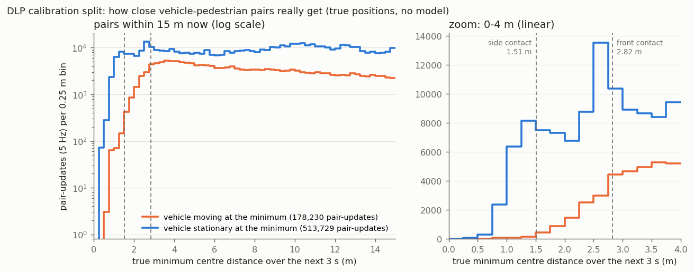
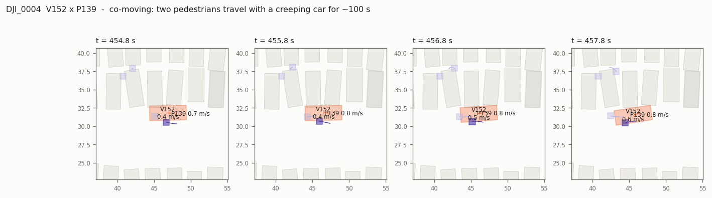
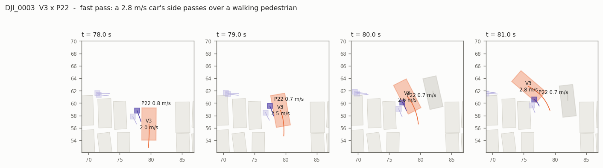
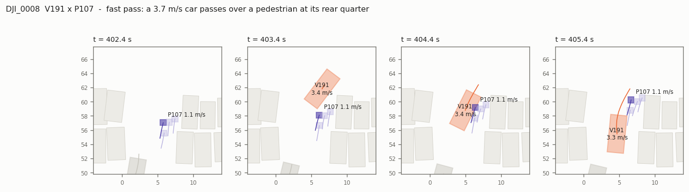

# DLP: what counts as a dangerous event

> **Inherited decision.** This definition was made in the original version of
> this project on 2026-10-11, before any model output on DLP existed. It is
> adopted here unchanged so results stay comparable, and is not a new decision:
> this repository was built after those results were known. The commits cited
> below (`b29a763`, `5f37900`) are in the original, private repository. All
> numbers in this document are reproduced by this repository's
> `eval/dlp_labels.py` and `eval/dlp_label_quality.py`.

Before any model runs on DLP, this document fixes the event that the risk
score will be judged against: *a vehicle and a pedestrian come closer than d\*
while the vehicle is moving*. Everything here comes from **true positions in
the 10 calibration recordings** (`data/dlp/splits.json`). No model output
exists yet, and the 6 test recordings were not read.

```bash
python -m eval.dlp_labels      # eval/results/dlp_label_*.csv (31 s; cached in eval/cache/)
python -m eval.dlp_figures     # docs/figures/dlp_label_min_distance.png
```

## Method

* **Pair-updates.** Every vehicle × pedestrian pair, every 0.2 s (5 Hz, the
  live risk cadence: every 12th 60 Hz tick), in the converted recordings.
* **Window.** [t, t + 3 s) at 60 Hz, the span the live risk grid covers.
* **Quantities.** Per pair-update:
  * `d_min`: the true minimum **centre** distance in the window;
  * `moving_at_min`: whether the vehicle's speed exceeds 0.5 m/s at that
    minimum;
  * `d_min_moving`: the smallest distance at any instant while the vehicle
    is moving.
* **Event(d).** `d_min_moving < d`: at some instant in the next 3 s the
  centres are closer than d **and** the vehicle is moving faster than 0.5 m/s.
  The simpler "closest point and moving at that point" version is in
  `dlp_label_base_rates.csv`; it gives 4–20% fewer positives and the same
  picture.
* **Censoring.** A pair-update is kept only if both agents are present for
  the whole window. A track that ends inside the window (at the drone's view
  edge, at the recording's end, or by a real exit) has an unobserved future.
  This dropped 275,413 of 6,993,107 pair-updates (3.9%); 6,717,694 remain
  (`dlp_label_censoring.csv`).

## Sizes (DLP `size` fields, calibration recordings)

| | n | p5 | median | p95 |
|---|---|---|---|---|
| vehicle half-width (m) | 391 | 0.96 | **1.09** | 1.19 |
| vehicle half-length (m) | 391 | 2.16 | **2.41** | 2.61 |
| parked-car half-width (m) | 2,220 | 0.93 | 1.05 | 1.37 |
| pedestrian half-size (m) | 1,099 | 0.416 | **0.416** | 0.416 |

Every DLP pedestrian has the same 0.83 × 0.83 m box. With median sizes, the
boxes touch at a centre distance of **1.51 m beside** a car and **2.82 m in
front of or behind** it. A centre-distance threshold is therefore a very
different gap depending on direction. The current risk code (and the
simulator's 2.2 m buffer = 0.9 + 0.3 + 1.0 m margin) uses isotropic centre
distance. With DLP's sizes, the same construction gives 1.09 + 0.42 + 1.0 =
**2.51 m**.

## Base rates of the event

Per 10,000 pair-updates (`dlp_label_base_rates.csv`). *Within 15 m* means
the pair is less than 15 m apart now (691,959 pair-updates, 10.3% of all).

| d (m) | Positives | All pairs, per 10k | Within 15 m, per 10k | Within 15 m, any vehicle speed, per 10k | Moving share of close approaches | Calibration recordings with 0 events |
|---|---|---|---|---|---|---|
| 1.0 | 81 | 0.12 | 1.2 | 40 | 3% | 7 of 10 |
| 1.5 | 382 | 0.57 | 5.5 | 253 | 2% | 3 |
| 2.0 | 1,799 | 2.7 | 26 | 486 | 5% | 1 |
| 2.5 | 5,945 | 8.8 | 86 | 768 | 11% | 1 (DJI_0001) |
| 3.0 | 13,697 | 20.4 | 197 | 1,221 | 16% | 0 |

* **Almost every positive is a pair within 15 m now**: 99.7% at 2.5 m.
  Over all pairs, 90% of pair-updates are far apart and trivially negative.
  An ECE over all pairs will look good mostly because of them, which is why
  every calibration metric in Part 2 is also reported within 15 m.
* **Most close approaches involve a stationary vehicle.** Within 2.5 m, 89%
  of close approaches happen while the vehicle stands still (people walking
  between parked cars and to their own car). The "moving" condition is what
  separates a conflict from walking past a parked car.
* **Per-recording spread is large.** Within 15 m at 2.5 m, DJI_0001 has 0
  events and DJI_0015 has 130 per 10k
  (`dlp_label_base_rates_per_recording.csv`). This is why the confidence
  intervals must resample recordings, not pair-updates.

**Encounters, not pair-updates, are the sample size.** Consecutive updates
of one approach are nearly copies of each other. An *encounter* is a run of
positive updates for one pair, with gaps of at most 1 s
(`dlp_label_encounters.csv`):

| d (m) | Positive pair-updates | Encounters (calibration, 70.7 min) | Expected in test (40.2 min, pro rata) |
|---|---|---|---|
| 1.0 | 81 | 5 | ~3 |
| 1.5 | 382 | 17 | ~10 |
| 2.0 | 1,799 | 96 | ~55 |
| 2.5 | 5,945 | 325 | ~185 |
| 3.0 | 13,697 | 703 | ~400 |

## Geometry of the events

At the closest moving instant, the pedestrian's position in the vehicle's
frame and the real gap between the two boxes (`dlp_label_event_geometry.csv`):

| d (m) | Events | Boxes overlapping (gap ≤ 0) | Median gap (m) | p90 gap (m) | Pedestrian ahead/behind (vs beside) |
|---|---|---|---|---|---|
| 1.0 | 81 | **99%** | −0.42 | 0.00 | 0% |
| 1.5 | 382 | **90%** | −0.32 | 0.01 | 5% |
| 2.0 | 1,799 | 30% | 0.17 | 0.47 | 5% |
| 2.5 | 5,945 | 10% | 0.63 | 0.92 | 2% |
| 3.0 | 13,697 | 5% | 0.93 | 1.37 | 1% |

* **Below 2 m, the label measures box overlap, not near misses.** At
  d < 1.5 m, nine in ten events have a pedestrian box inside a moving car's
  box. I checked whether these are people getting in or out: only 17% of
  them have the pedestrian's track start or end (uncensored) within 15 s,
  against 5–28% for ordinary events. So boarding does not explain them, and I
  have not found what does. Candidates are DLP's oversized fixed pedestrian
  box, drone parallax on tall vehicles, or people walking right alongside
  creeping cars. It is not resolvable without the video.
* **Close approaches are beside the car,** not in front of it (≥ 95% at
  every d). In a car park, people walk along the aisles next to slow cars;
  head-on approaches inside 3 s are rare.



*Left: pairs within 15 m, log scale. Right: the 0–4 m zoom, linear. Moving
vehicles (orange) almost never come within side-contact distance. Stationary
ones (blue) do, constantly. The stationary peak at 2.5–2.75 m is people
walking past parked cars.*

## Proposal: d\* = 2.5 m

1. **Same construction as the simulator's buffer, with measured sizes.**
   Vehicle half-width 1.09 + pedestrian half-size 0.42 + a 1 m margin = 2.51 m.
   The existing 2.2 m was the same formula with assumed sizes (0.9 + 0.3 + 1.0).
2. **It means something physical.** At 2.5 m the median real gap is 0.63 m
   (p90 0.92 m): a moving car passing within arm's reach. Only 10% of events
   are overlapping boxes, against 30% at 2.0 m and 90% at 1.5 m, where the
   label is dominated by the unexplained overlaps.
3. **There is enough to calibrate on.** 325 calibration encounters and about
   185 expected in test, against about 55 at 2.0 m. With 6 test recordings,
   2.0 m would leave reliability bins with a handful of independent events.

**Costs, stated plainly.**

* One calibration recording (DJI_0001) has no events at 2.5 m.
* Centre distance is isotropic, so a pedestrian 0.3 m in front of a bumper
  (centre distance about 3.1 m) is *not* an event at 2.5 m. Front and back
  approaches are only 1–5% of events here. The score uses the same isotropic
  distance (Part 2 runs it with `safety_buffer_m = d*`), so score and label at
  least estimate the same thing.

**Alternative: d\* = 3.0 m.** Twice the encounters (703, no recording with
zero) and it covers bumper contact (2.82 m), but the median gap of 0.93 m is
an ordinary close pass in a car park rather than a conflict. I would choose
it if statistical power matters more than the event's meaning.

**Not recommended:** 1.0 and 1.5 m (5 and 17 encounters in 70 minutes,
mostly overlapping boxes); 2.0 m (30% overlaps, about 55 test encounters).

## Decision record

**Chosen 2026-10-11, before any model output on DLP existed:**

* **Primary event:** d\* = **2.5 m** true centre distance at some instant in
  the next 3 s, with the vehicle **moving faster than 0.5 m/s** at that instant.
* **Reason:** the threshold is derived from DLP's own sizes, vehicle
  half-width 1.09 m + half pedestrian box 0.42 m + 1.0 m margin, which is the
  same formula as the simulator's 2.2 m buffer. The risk score's
  `safety_buffer_m` is set to the same 2.5 m, so the score and the event
  measure the same quantity.
* **Pre-declared secondary analyses**, reported alongside the primary and
  never swapped in for it: d = 2.0 m and d = 3.0 m; moving threshold 1.0 m/s.
* **Basis:** the label code and every number above are at commit `b29a763`
  (branch `dlp-eval`). The decision itself is the commit that adds this
  section: **`5f37900`** (2026-10-11).

## Label quality: the "impossible overlap" positives

At d\* = 2.5 m, **586 of 5,945** positive pair-updates (34 encounters) have
the pedestrian's box overlapping a moving vehicle's box at the closest moving
instant. Calibration split only; `python -m eval.dlp_label_quality`.

**The 10 most severe**, by encounter, deepest overlap first
(`eval/results/dlp_label_overlaps.csv`). A gap of −0.42 m means the
pedestrian's centre is inside the vehicle's box. lon/lat is the pedestrian's
position in the vehicle frame (+lon = ahead of the centre).

| Recording | t (s) (encounter) | Pair | Box gap (m) | lon / lat (m) | Vehicle (m/s) | Relative speed (m/s) | Flagged |
|---|---|---|---|---|---|---|---|
| DJI_0004 | 456.8 (453.8–468.4 s, 74 updates) | V152 × P139 | −0.42 | +1.0 / +1.0 | 0.5 | 0.3 | yes |
| DJI_0004 | 426.2 (426.2–435.8 s, 49 updates) | V152 × P139 | −0.42 | +0.1 / +0.5 | 0.5 | 0.2 | yes |
| DJI_0004 | 482.0 (478.2–485.8 s, 39 updates) | V152 × P139 | −0.42 | +1.2 / +0.7 | 0.8 | 0.2 | yes |
| DJI_0004 | 431.8 (428.2–435.8 s, 39 updates) | V152 × P140 | −0.42 | +0.7 / −0.9 | 0.6 | 0.2 | yes |
| DJI_0008 | 303.6 (302.6–307.8 s, 27 updates) | V152 × P106 | −0.42 | +0.2 / −1.1 | 0.8 | 1.7 | no |
| DJI_0004 | 448.0 (448.0–453.0 s, 26 updates) | V152 × P140 | −0.42 | +1.8 / +0.6 | 0.5 | 0.2 | yes |
| DJI_0003 | 80.0 (76.2–81.0 s, 25 updates) | V3 × P22 | −0.42 | −0.5 / +1.1 | 2.6 | 2.0 | no |
| DJI_0004 | 471.8 (471.8–476.2 s, 23 updates) | V152 × P139 | −0.42 | +0.2 / +0.8 | 0.5 | 0.5 | no (0.53 m/s) |
| DJI_0006 | 264.2 (260.4–264.6 s, 22 updates) | V108 × P85 | −0.42 | −1.5 / −1.0 | 0.9 | 2.1 | no |
| DJI_0008 | 404.4 (403.2–404.6 s, 8 updates) | V191 × P107 | −0.42 | −1.0 / +1.1 | 3.4 | 4.3 | no |

**Replay stills.** Four snapshots 1 s apart in one fixed view centred on the
event. The pair is highlighted with 2 s trails; parked cars are grey.





**What I think is happening.** There are no ID swaps or merges: every
pedestrian track in the list is continuous (no jump faster than 1.8 m/s) and
keeps its identity before and after. There are two different situations.

1. **People travelling with a car** (DJI_0004, V152 with P139 and P140, about
   100 s): a car creeps at 0.4–0.8 m/s with two people at its rear-side
   corner, matching its speed (relative speed 0.2–0.3 m/s). They are
   escorting, guiding or walking with it, not being nearly hit by it. As a
   "moving-vehicle conflict" label this is an **artifact**. Boarding, the
   earlier guess, explains few of these (17% of overlaps have the
   pedestrian's track start or end within 15 s).
2. **Fast, very close passes** (DJI_0003 V3 × P22, DJI_0008 V191 × P107, and
   the rest): a car at 2–4 m/s turns past a walking pedestrian, or through a
   line of them, and the tracked boxes overlap by up to 0.4 m. A body is
   about 0.5 m across but DLP's pedestrian box is 0.83 m, and turning cars
   are hard to box, so this looks like a real close pass measured ~0.5 m too
   close. **The label is right either way:** with 0.5 m more gap, the centres
   are still well within 2.5 m of a moving car.

**`overlap_artifact` rule** (`eval/dlp_labels.overlap_artifact`, decided on the
calibration split): at the closest moving instant the pedestrian is **inside
or touching the vehicle's box (box gap ≤ 0) and travelling with it (relative
speed < 0.5 m/s)**. Fast passes with overlapping boxes are deliberately not
flagged; removing them would remove the most dangerous real events.

| | Calibration positives at d\* |
|---|---|
| all positives | 5,945 |
| box overlap (gap ≤ 0) | 586 |
| **flagged `overlap_artifact`** | **275 (4.6%)**: 9 encounters in 4 pairs; 235 of them are DJI_0004 V152 |
| sensitivity: relative speed < 0.5 m/s at any gap | 471 |
| sensitivity: gap < −0.17 m at any speed (bodies would interpenetrate) | 379 |

The rule works per instant, so one stretch of the DJI_0004 episode
(471.8–476.2 s, relative speed 0.53 m/s) escapes it. I left it that way
rather than tune the threshold.

**Use.** Flagged events **stay in the primary analysis**. The main
calibration results are also reported with flagged positive pair-updates
excluded, as a secondary row. The rule is applied unchanged to the test split.
